<!-- ═══════════════════════════════  HEADER  ═══════════════════════════════ -->

  
  
  
  

  

 

  
  
  

## `> ls ~/arsenal`

<table>
<tr><td><b>⌨️ Languages</b></td><td>

</td></tr>
<tr><td><b>🌐 Web</b></td><td>

</td></tr>
<tr><td><b>📱 Mobile</b></td><td>

</td></tr>
<tr><td><b>🛠️ Tools & DevOps</b></td><td>

</td></tr>

## `> ./snake --eat-contributions`

  <picture>
    <source media="(prefers-color-scheme: dark)" srcset="https://raw.githubusercontent.com/radasanuflorin/radasanuflorin/output/snake-dark.svg"/>
    <source media="(prefers-color-scheme: light)" srcset="https://raw.githubusercontent.com/radasanuflorin/radasanuflorin/output/snake-light.svg"/>
    
  </picture>

<!-- ═══════════════════════════════  FOOTER  ═══════════════════════════════ -->

  

